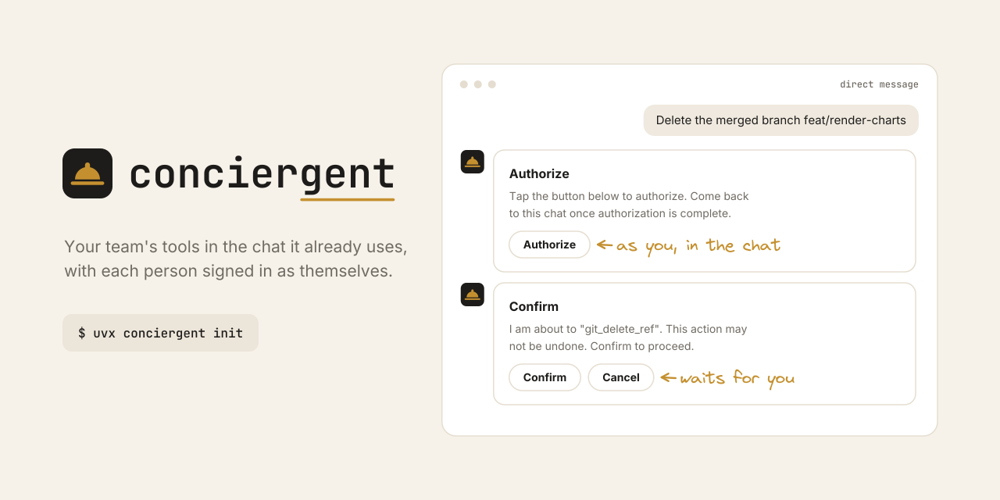

<p align="center">
  <a href="https://github.com/mroops0111/conciergent/actions/workflows/ci.yml"></a>
  <a href="https://pypi.org/project/conciergent/"></a>
  <a href="https://pepy.tech/projects/conciergent"></a>
  <a href="https://pypi.org/project/conciergent/"></a>
  <a href="LICENSE"></a>
</p>

Conciergent puts your team's tools in the chat it already uses. Connect any [Model Context Protocol (MCP)](https://modelcontextprotocol.io/) server or OpenAPI spec, and it becomes a Slack, LINE, or Discord bot the whole team shares. In a direct message, each person signs in to your tools as themselves, so the bot acts only with the permissions of whoever asked. One YAML file sets it up, with no bot code to write.

Conciergent pairs with its sister project [openapi-mcp-gateway](https://github.com/mroops0111/openapi-mcp-gateway), which turns any REST API into MCP tools. Together they take one or more OpenAPI specs all the way to a chatbot your users can talk to.

- **Each Person Signed in as Themselves.** When a tool needs authorization, Conciergent shows the link in the chat, then stores and refreshes that user's own token. Everyone shares one bot, but a direct-message turn runs with the account of whoever asked, and anyone can ask to sign out at any time to revoke theirs.
- **Human-in-the-Loop.** Any tool the server marks destructive pauses behind a Confirm / Cancel card before it runs.
- **Any MCP Server, or an OpenAPI Spec Directly.** Point Conciergent at an MCP URL, or set `gateway.enabled` and drop in a spec. It embeds openapi-mcp-gateway in-process, no second server to run.
- **Surface-Agnostic Rich Replies.** The agent emits one structured reply, and each surface renders it natively.
- **Group Chats and Pushes.** The same bot can answer in a group chat, and can speak first when a scheduler runs `conciergent push`. Neither runs a per-user sign-in, so both use only tools that work without one.

## Quick Start

Two things are yours to set up once. Register a chat app with a public webhook URL, and have a Redis and a Postgres to run against (the [Docker](#4-run) path below provides both). Everything else is `${ENV_VAR}` in one YAML file.

### 1. Install and Scaffold

```bash
uv add conciergent
uv run conciergent init
```

`uv run conciergent init` writes an annotated `manifest.yml`, deep-merged over the shipped defaults so you set only what you change.

### 2. Configure Your MCP Tools

Conciergent reaches your tools two ways, and you can use both at once.

#### Connect an MCP Server

List any MCP server URL under `agent.mcp_servers`. The scaffolded `manifest.yml` already has the surface and store set up around it.

```yaml
# manifest.yml
agent:
  model: openai:gpt-6-luna
  system_prompt: |
    You are a helpful assistant. Use your tools to answer the user's requests.
  mcp_servers:
    - http://localhost:9000/mcp
    - https://another-server.example.com/mcp
```

If a server uses OAuth, Conciergent runs the in-chat authorization handoff the first time a tool needs it, with no extra config.

#### Or Embed an OpenAPI Spec

Add the `gateway` extra and let Conciergent embed openapi-mcp-gateway in-process, so a spec becomes MCP tools with no second server to run.

```bash
uv add "conciergent[gateway]"
```

```yaml
gateway:
  enabled: true
  # Keeps the gateway's OAuth clients across restarts.
  redis_url: ${CONCIERGENT_MESSAGES_URL:-redis://localhost:6379/0}
  specs:
    - name: github
      spec: https://raw.githubusercontent.com/github/rest-api-description/main/descriptions/api.github.com/api.github.com.json
      base_url: https://api.github.com
      policy:
        allow: ["pulls/*", "issues/*", "git/delete-ref"]
    - name: internal
      spec: ./internal-api.json
```

Each spec is served at `/{name}/mcp` and wired into the agent for you, alongside anything already in `agent.mcp_servers`. A complete runnable config lives at [`examples/openapi-chat.yml`](examples/openapi-chat.yml).

A spec entry takes [openapi-mcp-gateway's per-server options](https://github.com/mroops0111/openapi-mcp-gateway#configuration), such as a `policy` that picks the operations to expose and `auth`. An `oauth2` spec runs the same in-chat OAuth handoff, so each user authorizes their own account before its tools run.

### 3. Connect Your Chat App

Conciergent replies in direct messages, and the in-chat OAuth happens there too. Group chats are opt-in, see [Group Chats](#group-chats). Register the app once and set its request URLs, where `{your-public-url}` is your public host.

<details>
<summary><b>Slack</b></summary>

Create the app from [`examples/manifest-slack.yml`](examples/manifest-slack.yml), which fills these in for you.

| Setting | URL |
|---|---|
| Event Subscriptions Request URL | `https://{your-public-url}/slack/events` |
| Interactivity Request URL | `https://{your-public-url}/slack/interactions` |
| OAuth Redirect URL *(multi-workspace install only)* | `https://{your-public-url}/oauth/slack/callback` |

</details>

<details>
<summary><b>LINE</b></summary>

In the [LINE Developers console](https://developers.line.biz/console/):

1. Create a **provider**, then a **Messaging API channel** under it.
2. Copy the **Channel secret** (Basic settings) and issue a long-lived **Channel access token** (Messaging API tab) into `LINE_CHANNEL_SECRET` and `LINE_CHANNEL_ACCESS_TOKEN`.
3. Set the webhook URL and turn **Use webhook** on:
   - Messaging API Webhook URL: `https://{your-public-url}/line/events`
4. In the [LINE Official Account Manager](https://manager.line.biz/), turn **auto-reply** and **greeting messages** off, so the bot owns every reply.

Conciergent answers with the event's one-time reply token when it can and falls back to a push message otherwise, so the channel access token needs push messages enabled.

</details>

<details>
<summary><b>Discord</b></summary>

In the [Discord Developer Portal](https://discord.com/developers/applications):

1. Create an **application**, add a **Bot**, and copy its **token** into `DISCORD_BOT_TOKEN`.
2. Enable the bot's **Direct Messages** intent. It is non-privileged, and direct-message content is exempt from the message-content intent.
3. Invite the bot to a server you also belong to, so it can open a direct-message channel with you.

Discord delivers direct messages over a gateway connection the bot holds open, so there is no webhook URL to register. It connects on startup and replies in direct messages.

</details>

The MCP OAuth return (`/oauth/mcp/callback`) is registered with the MCP server automatically, so it is not something you set in a dashboard. For local development, run a tunnel (cloudflared / ngrok) in front of the port and use its URL as `{your-public-url}` and as `server.url`.

### 4. Run

Two ways, depending on whether you already have Redis and Postgres.

Against your own Redis and Postgres:

```bash
# The database must exist, and Conciergent creates its tables on first run.
createdb conciergent
uv run conciergent run
```

Or with Docker, which brings up Redis, Postgres, and the app together and needs no uv:

```bash
# Start from an example, or bring your own manifest.
cp examples/openapi-chat.yml manifest.yml
docker compose up
```

Secrets stay in the environment. `manifest.yml` reads the Slack, LINE, Discord, and provider credentials through `${...}`, so nothing sensitive is committed. The app serves on port 8000, so put your tunnel in front of it and set `server.url` to the tunnel URL.

Each release also publishes the app image to `ghcr.io/mroops0111/conciergent` for linux/amd64 and linux/arm64, tagged with the version and `latest`, with the `gateway` extra included. To use it from your own compose file, replace `build: .` in the `app` service with `image: ghcr.io/mroops0111/conciergent:<version>`, and keep `manifest.yml` mounted at `/home/app/manifest.yml`.

## Architecture

A message comes in through a surface, runs as one agent turn over your MCP tools, and goes back as one reply the surface renders natively.

![Conciergent architecture. A chat user on Slack, LINE, or Discord sends a message to a surface, which verifies it and hands it to the turn. The turn loads history and pending approvals from Redis and runs the agent, built on Pydantic AI, which calls any MCP server over MCP and the embedded gateway in process, and the gateway calls your REST APIs over HTTP. Per-user MCP and bot tokens are kept in Postgres. The surface renders the result back to the user as a reply, an Authorize card for OAuth in the chat, or a Confirm card before a destructive tool. A scheduler can also start a turn with conciergent push, and manifest.yml is read at startup.](docs/assets/architecture.svg)

## Configuration

Conciergent reads one `manifest.yml`, merged over the shipped defaults, so you set only what you change. `${VAR}` / `${VAR:-default}` resolve in any string field.

Three model providers ship in the box. Set `agent.model` to a `provider:model` string and export that provider's API key.

| Provider | `agent.model` | API key |
|---|---|---|
| OpenAI | `openai:<model>` | `OPENAI_API_KEY` |
| Google Gemini | `google:<model>` | `GOOGLE_API_KEY` |
| Anthropic Claude | `anthropic:<model>` | `ANTHROPIC_API_KEY` |

The shipped default is `openai:gpt-6-luna`. Any model the provider offers works, so pick the current one from its docs.

<details>
<summary><b>Config Reference</b></summary>

| Field | Default | Description |
|---|---|---|
| `server.host` | `127.0.0.1` | Bind address. Use `0.0.0.0` to accept connections from other hosts. |
| `server.port` | `8000` | Bind port. |
| `server.url` | *(from host/port)* | Public URL external services reach. Set this behind a tunnel or proxy. |
| `agent.model` | `openai:gpt-6-luna` | A `provider:model` string for one of the three providers above. |
| `agent.system_prompt` | *(generic assistant)* | Your assistant's instructions. |
| `agent.mcp_servers` | `[]` | MCP server URLs the agent connects to. |
| `agent.input_token_limit` | `null` | Overrides the context window used for history compaction. Unset auto-detects it per model. |
| `agent.mcp_read_timeout_seconds` | `300` | Per-call MCP read timeout. Must exceed `conversation.oauth_wait_timeout_seconds`, since a missing token runs OAuth inside the connect. |
| `agent.mcp_probe_timeout_seconds` | `10` | Group chats only. How long the no-credential probe of an MCP server waits. |
| `agent.mcp_probe_retry_seconds` | `60` | Group chats only. When an unreachable MCP server is probed again. |
| `agent.client_name` | `conciergent` | Name shown on the MCP OAuth screen. |
| `surface.slack.enabled` | `false` | Turn the Slack surface on. |
| `surface.slack.signing_secret` | *(required if enabled)* | Verifies inbound Slack signatures. |
| `surface.slack.bot_token` | *(empty)* | Single-workspace bot token. |
| `surface.slack.client_id` · `client_secret` | *(empty)* | Set both for the multi-workspace install flow. |
| `surface.slack.brand_color` · `destructive_color` | `#586af2` · `#DC3545` | Card accent colors. |
| `surface.line.enabled` | `false` | Turn the LINE surface on. |
| `surface.line.channel_secret` · `channel_access_token` | *(required if enabled)* | LINE Messaging API credentials. |
| `surface.discord.enabled` | `false` | Turn the Discord surface on. |
| `surface.discord.bot_token` | *(required if enabled)* | Discord bot token. The bot connects over the gateway, so no webhook URL is needed. |
| `surface.<name>.group_chats.enabled` | `false` | Answer in group chats as well as direct messages. See [Group Chats](#group-chats). |
| `surface.<name>.group_chats.reply_trigger` | `mention` | `mention` answers only messages that mention the bot. `every_message` answers every message in a group chat. |
| `store.messages_url` | *(required)* | Redis URL. Holds message state that expires (history, approvals, dedupe, OAuth handoff). |
| `store.credentials_url` | *(required)* | Postgres URL (any SQLAlchemy async engine). Holds credentials that survive a restart (MCP and bot tokens). |
| `store.max_turns` | `10` | Recent turns kept in history. |
| `gateway.enabled` | `false` | Embed openapi-mcp-gateway in-process. |
| `gateway.redis_url` | *(required if enabled)* | Redis URL where the gateway keeps its OAuth client registrations across restarts. The app's own Redis works. |
| `gateway.specs` | `[]` | `{name, spec, base_url}` entries, each mounted at `/{name}/mcp`. |
| `capability.chart.enabled` | `false` | Let the agent answer with a chart. See [Charts](#charts). |
| `conversation.approval_ttl_seconds` | `600` | How long a pending approval waits. |
| `conversation.history_ttl_seconds` | `604800` | History retention (one week). |
| `conversation.oauth_wait_timeout_seconds` | `240` | How long an in-chat OAuth handoff blocks. |
| `pushes` | `[]` | Prompts `conciergent push` runs, sending each reply into a chat. See [Pushes](#pushes). |
| `logger.level` · `format` · `file` | `INFO` · `text` · *(none)* | Logging. `format` is `text` or `json`. |
| `locales_dir` | `null` | Directory of `{lang}.yml` files overriding shipped UI text. |

</details>

### Localizing Text

Button labels, prompts, and greetings are not config. They live in a locale catalog, picked from each user's Slack, LINE, or Discord language. Set `locales_dir` to a directory of `{lang}.yml` files to rebrand or translate. [`examples/locales/en.yml`](examples/locales/en.yml) is the full English catalog to start from.

### Group Chats

Each surface can also answer in group chats, a LINE group, a Slack channel, or a Discord server channel. It is off by default, and once on the bot answers in any group chat it is added to, the same openness as its direct messages.

Turn group chats on per surface.

```yaml
surface:
  line:
    enabled: true
    channel_secret: ${LINE_CHANNEL_SECRET}
    channel_access_token: ${LINE_CHANNEL_ACCESS_TOKEN}
    group_chats:
      enabled: true
      # Set every_message to answer every message in the group chat.
      reply_trigger: mention
```

<a name="requirement"></a>
<details>
<summary><b>Requirement</b></summary>

A group is shared by several people, so it never runs a per-user OAuth. Group chats are served only when every MCP tool works without a user's token.

- **Embedded Gateway Specs**: a spec with no `auth`, a static `bearer` or `api_key`, or an `oauth2` spec with `flow: client_credentials` works in group chats. Any other `oauth2` spec fails config validation while group chats are on.
- **Other MCP Servers**: Conciergent sends each one an unauthenticated `initialize` at startup. A `401` or `403` means it needs a user's token, which turns group chats off and logs an error. An unreachable server pauses group chats, and is probed again after `agent.mcp_probe_retry_seconds`.

</details>

<details>
<summary><b>Behavior</b></summary>

A group shares one conversation while every member keeps their own identity.

- **Shared History**: everyone in the group, or in the Slack thread, shares one history. Each message reaches the agent prefixed with its speaker's name, so it can tell the members apart.
- **Mentions**: with `reply_trigger: mention` a typed message starts a turn only when it mentions the bot, and the mention is removed before the agent sees it. Tapping a suggestion or a Confirm / Cancel button never needs a mention.
- **Approvals**: a confirmation belongs to the member whose request parked it. Only they can confirm or cancel it, and other members' messages leave it waiting. Another member's tap on it is ignored on every surface.
- **Addressed Replies**: a text reply to a typed message shows who it answers, as a quote on LINE, a native reply on Discord, and a mention on Slack. Cards and replies to a button tap are not marked, since LINE cannot quote from a card and a tap has no message to answer.
- **No Authorization**: a group turn never shows an authorize link and hides the sign-out tool, since a sign-out would clear the whole group's history.

</details>

#### Surface Setup

Each platform needs a little more setup before the bot can read a group.

<details>
<summary><b>LINE</b></summary>

- **Joining Groups**: turn on **Allow bot to join group chats** in the LINE Official Account Manager or the channel's Messaging API settings, then invite the bot.
- **Push Quota**: a reply past the free reply token is a push message, and a push to a group counts once per member against the monthly message quota.

</details>

<details>
<summary><b>Slack</b></summary>

- **Mention Mode**: subscribe to the `app_mention` bot event and add the `app_mentions:read` scope.
- **Every-Message Mode**: subscribe to `message.channels`, `message.groups`, and `message.mpim`, and add `channels:history`, `groups:history`, and `mpim:history`.
- **Threads**: the bot replies in a thread, and each thread is its own conversation. Invite the bot to the channel, and reinstall the app after adding scopes. The multi-workspace install flow requests these scopes for you.

</details>

<details>
<summary><b>Discord</b></summary>

- **Mention Mode**: needs no extra setup. Discord delivers a server message's content to a bot it mentions, even without the message-content intent.
- **Every-Message Mode**: enable the privileged **Message Content Intent** on the bot in the Developer Portal. If Discord refuses it, the bot logs an error and answers mentions only, while direct messages keep working.

</details>

### Pushes

The agent can also speak first. A push is a prompt that `conciergent push` runs with no incoming message, sending the agent's reply into a chat, such as a daily digest or a reminder drawn from your tools. Pushing is LINE only for now.

conciergent has no scheduler of its own. When and how often a push runs is up to whatever runs the command, such as cron, a Kubernetes CronJob, or Cloud Scheduler, so timing, retries, and run history come from a tool built for them.

```yaml
pushes:
  - name: vaccine-reminder
    timezone: Asia/Taipei
    target:
      surface: line
      # A LINE user (U...), group (C...), or room (R...) id.
      to: ${LINE_NOTIFY_TARGET}
    allow_skip: true
    failure_message: The reminder could not read its data today, please check the server.
    prompt: |
      List vaccine doses due within 7 days. When none are due, call skip_reply.
```

| Field | Default | Description |
|---|---|---|
| `name` | *(required)* | Unique name, which `conciergent push` takes and the agent sees. |
| `timezone` | `UTC` | IANA zone the prompt header gives the start time in. |
| `prompt` | *(required)* | What the agent is asked, in the language it should reply in. |
| `target.surface` · `target.to` | *(required)* | The surface and the user or chat id to push to. |
| `allow_skip` | `false` | Lets the agent end with `skip_reply` and send nothing, for a prompt that only sometimes has news. |
| `allow_destructive` | `false` | Runs destructive tools without a confirmation. Unsafe, since nobody is present to confirm. |
| `failure_message` | *(none)* | Text pushed as-is when the turn fails, so an outage is not silent. |
| `reply.card` | *(none)* | A fixed card layout the agent fills. See [Reply Shape](#reply-shape). |

<a name="reply-shape"></a>
<details>
<summary><b>Reply Shape</b></summary>

`reply.card` fixes a push's card layout, so it stays the same every run. The agent fills only the gaps, and conciergent assembles the card in the declared order.

```yaml
reply:
  card:
    header: 'Daily summary for {store}'
    placeholders:
      store: {description: The store's name.}
    sections:
      - name: totals
        title: Totals
        # Fixed labels, so the agent writes only the values.
        labels: [Orders, {label: Refunds, required: false}]
      - name: anomalies
        title: Anomalies
        # Text, bullets, facts, or a list such as [text, facts].
        content: bullets
        description: Anything unusual, one bullet each.
        # Left out when the agent has nothing for it.
        required: false
```

| Keys | Role |
|---|---|
| `header`, `subtitle`, `footnote`, `title`, `labels` | Displayed as written. Each `{placeholder}` is a gap the agent fills. |
| `description` | Guidance for the agent, never displayed. |
| `pattern` | A regular expression a placeholder or label value must match. |

- **Repetition**: `repeated: true` on a section adds one section per item, each with its own title placeholders.
- **Retries**: a value off its `pattern`, a missing required value, or a card past a limit, such as a header over 40 characters, goes back to the agent to rewrite.
- **Config Checks**: a shape that uses an undeclared placeholder or repeats a section name fails the config.

</details>

#### Running

```bash
conciergent push vaccine-reminder --config manifest.yml
```

The command runs the push once and exits, serving nothing, so it can run beside the app, even inside its container. It reads the same config and env as the app. Tools from the embedded gateway are dialed at `server.url`, so the app must be up.

| Exit | Meaning | Retry |
|---|---|---|
| `0` | The reply was pushed, or the agent called `skip_reply`. A later step such as saving history may still have failed, which is logged. | No |
| `1` | The push failed before any reply was pushed, and `failure_message` was pushed when set. | Safe, though a retry that fails again pushes `failure_message` again |
| `2` | The config or the push name is invalid. | No |

<details>
<summary><b>Scheduling Examples</b></summary>

With cron on the host, where `CRON_TZ` sets the zone the times are read in:

```cron
CRON_TZ=Asia/Taipei
0 9 * * * cd /srv/app && docker compose exec -T app conciergent push vaccine-reminder --config /home/app/manifest.yml
```

With a Kubernetes CronJob, running the app image with the same env and config as the app:

```yaml
apiVersion: batch/v1
kind: CronJob
metadata:
  name: vaccine-reminder
spec:
  schedule: "0 9 * * *"
  timeZone: Asia/Taipei
  concurrencyPolicy: Forbid
  jobTemplate:
    spec:
      # Exit 1 is the only failure, and it is safe to retry.
      backoffLimit: 2
      template:
        spec:
          restartPolicy: Never
          containers:
            - name: push
              image: ghcr.io/mroops0111/conciergent:<version>
              args: ["push", "vaccine-reminder", "--config", "/home/app/manifest.yml"]
              # Mount manifest.yml and set the env exactly as for the app's own Deployment.
```

</details>

<details>
<summary><b>Behavior</b></summary>

- **Prompt Header**: the agent reads the prompt as `[Automated: <name>, <time> <timezone>, <weekday>] <prompt>`, so it knows what started the turn and what day it is.
- **Shared History**: the prompt and the reply join the target chat's conversation, so a follow-up there has the reply as context. A skipped turn adds nothing.
- **Authorization**: the turn holds no one's authorization, so every tool must work without a user's token, the same [requirement](#requirement) as group chats. A per-user gateway spec fails the config, which `push` reports with exit 2. Another MCP server that needs a user's token is found when the turn starts, which fails the push with exit 1 and pushes `failure_message`.
- **Destructive Tools**: nobody can confirm one, so they are left out of the turn unless `allow_destructive` is on.
- **Failures**: a turn that fails, including one whose tools are unreachable, is logged, and pushes `failure_message` when set.
- **Push Quota**: every reply is a LINE push message, and a push to a group counts once per member against the monthly message quota. Use `allow_skip` for prompts that often have nothing to say.

</details>

### Charts

The agent can answer with a chart. It writes a [Vega-Lite](https://vega.github.io/vega-lite/) spec from its tool results, and the chart is shown as the card's hero image.

```sh
uv add "conciergent[charts]"
```

```yaml
capability:
  chart:
    enabled: true
```

- **Hosting**: charts are served from `<server.url>/charts/`, which must be public HTTPS, since LINE fetches each image from the device and keeps no copy. A chart stays reachable for `capability.chart.ttl_seconds`, 90 days by default.
- **Fonts**: the Docker image ships Noto Sans CJK. Elsewhere, set `capability.chart.font` to a font that covers your users' scripts, since a missing font draws no text at all.

## The Reply Model

The agent never speaks Slack, LINE, or Discord. It emits one of three shapes, and each surface renders it natively.

- **`str`** for plain text.
- **`Card`** for a header with an optional subtitle, up to six sections, an optional hero image, a footnote, up to five link buttons, and up to three suggestion quick-replies. A section has an optional title, text, and either bullets or facts, which are label and value pairs such as counts and amounts.
- **`Carousel`** for one to four option cards the user picks between, plus a fallback card.

A suggestion is the interactive primitive. Tapping one posts its prompt back to the agent as if the user had typed it. The field descriptions on these models are the agent's structured-output schema, so the model fills them in directly.


## Extending

The paved road above needs no code. These are for teams who want to go further.

<details>
<summary><b>Add a Surface</b></summary>

A surface is one platform's whole contribution, behind a one-method contract. The app only ever speaks this interface, so a new platform is a new implementation passed to the app and nothing in the core changes.

```python
class Surface(abc.ABC):
    @abc.abstractmethod
    def build_routers(self, context: SurfaceContext) -> list[fastapi.APIRouter]:
        """Return the webhook and auxiliary routes this platform needs."""
```

Implement `Surface`, a `ReplySurface` to render the reply model, and (if it has per-user auth) an `OAuthBridge`, then pass an instance to the app. Slack, LINE, and Discord are the three that ship.

A platform that can also send a message nobody asked for implements `PushSurface` instead, which [pushes](#pushes) can then target.

```python
class PushSurface(Surface):
    @classmethod
    @abc.abstractmethod
    def push_conversation(cls, to: str) -> str:
        """The conversation a push to `to` joins, raising ValueError for an id the platform cannot push to."""

    @abc.abstractmethod
    def push_target(self, to: str) -> contextlib.AbstractAsyncContextManager[PushTarget]:
        """Open a push to `to`, yielding the reply surface that sends it."""
```

</details>

<details>
<summary><b>Add a Capability</b></summary>

An opt-in agent feature, such as [charts](#charts), subclasses `AppCapability`, a [Pydantic AI capability](https://ai.pydantic.dev/capabilities/) that can also serve routes. Pass it to both `ChatRunner(capabilities=...)` and `App(capabilities=...)`. To turn it on from YAML, add an `AppCapabilitySettings` subclass as a field of `CapabilitySettings`.

</details>

<details>
<summary><b>Use the Python API</b></summary>

`App.from_config` is the YAML path. For full control, assemble `App` directly, which is the same object the CLI builds. `App.build_asgi()` returns the FastAPI app if you would rather bring your own server.

```python
from conciergent import App, MessageStore, CredentialStore
from conciergent.agent.runner import ChatRunner
from conciergent.surfaces.slack.app import Slack

message_store = MessageStore.from_url('redis://localhost:6379/0')
credential_store = CredentialStore.from_url('postgresql+asyncpg://localhost/conciergent')

app = App(
    runner=ChatRunner(
        model='openai:gpt-6-luna',
        system_prompt='You are a helpful assistant.',
        mcp_servers=['http://localhost:9000/mcp'],
        credential_store=credential_store,
        redirect_uri='https://your-public-url/oauth/mcp/callback',
    ),
    surfaces=[Slack(signing_secret='...', bot_token='xoxb-...')],
    message_store=message_store,
    credential_store=credential_store,
    base_url='https://your-public-url',
)
app.run()
```

</details>

## License

[MIT](LICENSE)
